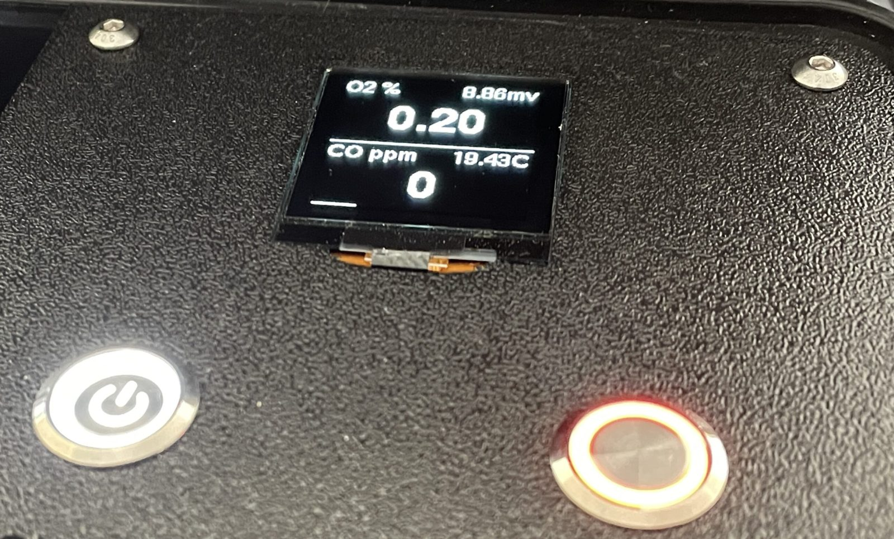
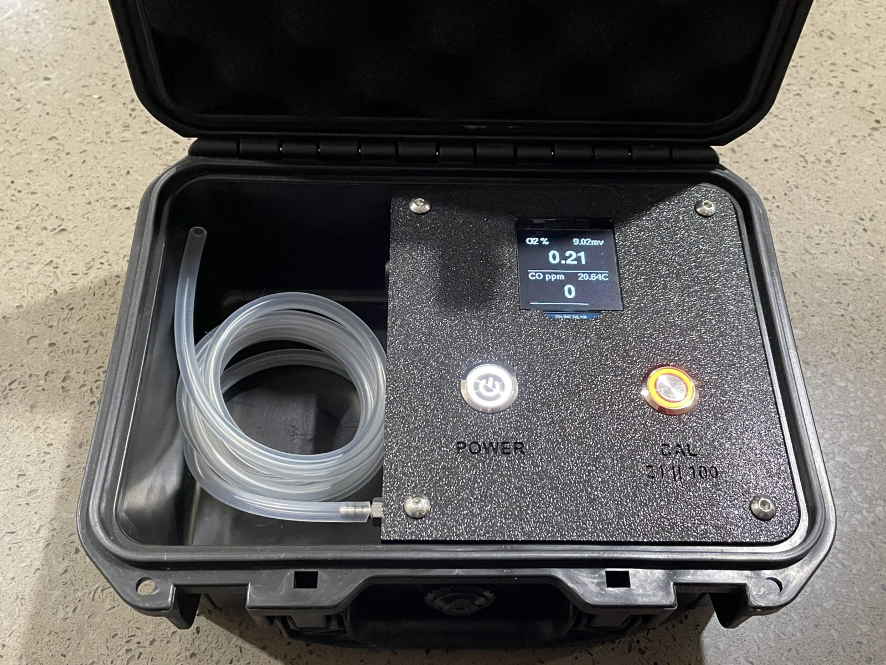
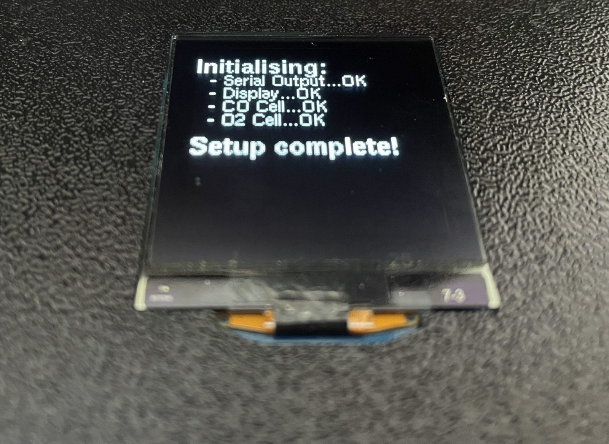
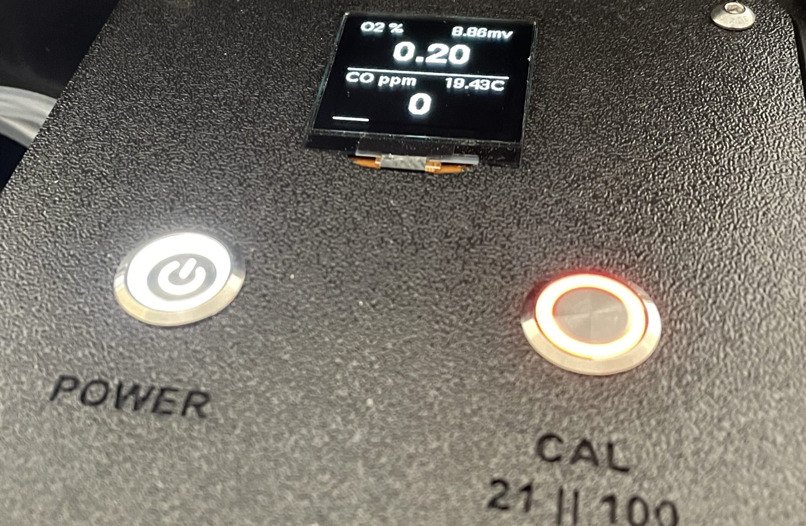
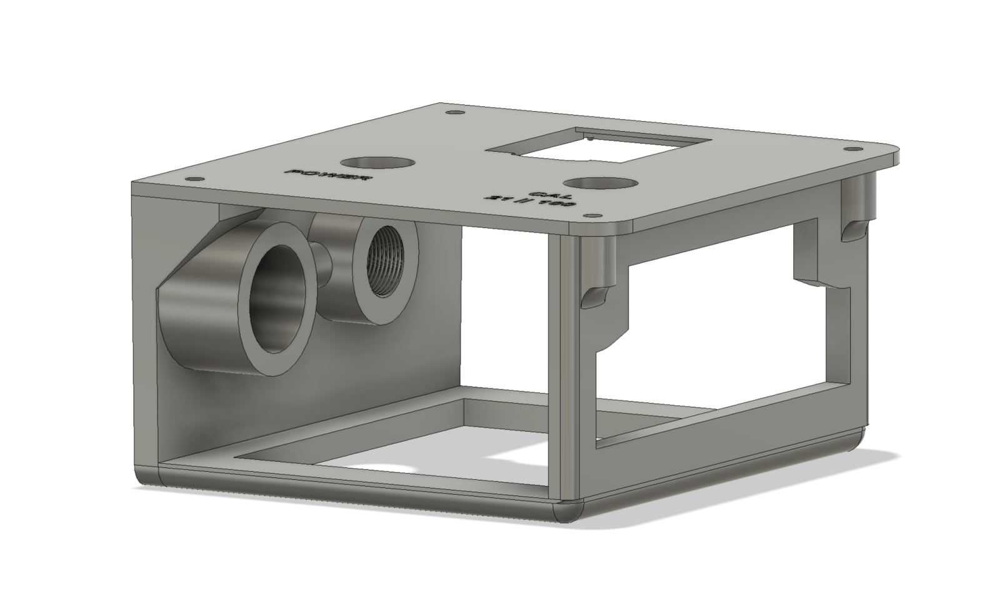

# Carbon Monoxide Oxygen Analyser

A low-cost DIY analyser that measures oxygen (O2) and carbon monoxide (CO) in diving gas at the same time. It's built around an ESP32-C3 Super Mini.

Project page: https://deepfocusau.github.io/CO-O2-Analyser/
Original write-up: [Carbon Monoxide Oxygen Analyser](https://damiensiviero.com/carbon-monoxide-oxygen-analyser/) on damiensiviero.com



> **Warning:** this is a cheap, poorly tested DIY build with rough code, not a commercial product. The CO sensor's maker states it must not be used for life support. Think about what your life is worth before you rely on one.

## Why

CO analysers sold for diving cost far more than comparable industrial safety analysers. So I built a dual analyser that tests a gas for O2 and CO in one go. The O2 side reuses a standard R22D oxygen cell that came out of my CCR after 12 months, which still has plenty of life left.

## What it does

- Shows O2 % (large), the O2 cell's millivolts, CO in ppm (large), and the CO sensor's temperature on a 1.5" 128×128 OLED.
- Averages 40 readings of the O2 cell through a 16-bit ADC for a steady value.
- Calibrates the O2 cell on air or pure oxygen at the press of a button, and remembers the calibration after power-off.
- Reads CO from a factory-calibrated electrochemical sensor: 0–1000 ppm, 1 ppm resolution.
- Runs on an 18650 cell, recharged through a USB-C socket on the case.

## Calibration

Press **CAL** while the O2 cell is exposed to the calibration gas. The firmware decides which gas it is from the cell's output:

| Cell output | Treated as | Calibration value |
| --- | --- | --- |
| 7–13 mV | Air | 20.7% O2 |
| Above 44 mV | Oxygen | 98% O2 |
| Anything else | Error | Shows `CAL ERROR` and stops until restarted |

The calibration is saved to flash (EEPROM) and loaded at start-up. On the very first start, the analyser calibrates straight away.

## Parts

| Part | Notes |
| --- | --- |
| ESP32-C3 Super Mini | Microcontroller |
| DFRobot CO sensor (SEN0466) | I2C (address 0x74). Factory calibrated, 0–1000 ppm, 1 ppm resolution, expected life over 2 years |
| R22D oxygen cell | Reclaimed from a CCR; connected with a Molex connector |
| ADS1115 16-bit ADC | I2C; reads the O2 cell differentially on A0–A1 |
| 1.5" 128×128 OLED | SH1107 driver, I2C |
| 18650 battery holder / UPS module | With an 18650 cell |
| USB-C socket | For charging |
| M16 toggle switch | Power |
| M16 momentary switch | Calibration |
| Pelican-style case | Cheap, but surprisingly decent |
| 3D-printed internal assembly | Holds everything in the case; M4 threaded inserts |
| Stainless barbs, 4 × M6 | Gas sample connections |

The display, ADC and CO sensor all share the I2C bus, so the wiring is simple.

## Wiring

| ESP32-C3 pin | Connects to |
| --- | --- |
| GPIO8 (SDA) | SDA on the OLED, ADS1115 and CO sensor |
| GPIO9 (SCL) | SCL on the OLED, ADS1115 and CO sensor |
| GPIO2 | Calibration button to GND (internal pull-up) |
| ADS1115 A0 / A1 | O2 cell + / − |

## Photos

 

 

## Building

The firmware is a basic Arduino-framework C++ program, written in VS Code with [PlatformIO](https://platformio.org/). It should port to other IDEs.

```bash
pio run -t upload
pio device monitor
```

Libraries (installed by PlatformIO): U8g2, Adafruit ADS1X15, RunningAverage, EasyButton. The DFRobot multi-gas sensor library (MIT licence, from [DFRobot/DFRobot_MultiGasSensor](https://github.com/DFRobot/DFRobot_MultiGasSensor)) is included in `src`.

3D-print files (STL and Fusion 360): [3D-Printed-Assembly.zip](https://damiensiviero.com/wp-content/uploads/2025/06/3D-Printed-Assembly.zip)

## Known limitations

- The code could do with some optimisation.
- It's lightly tested. Check it against a known gas before trusting a reading.
- CO temperature compensation is turned off in the firmware.
